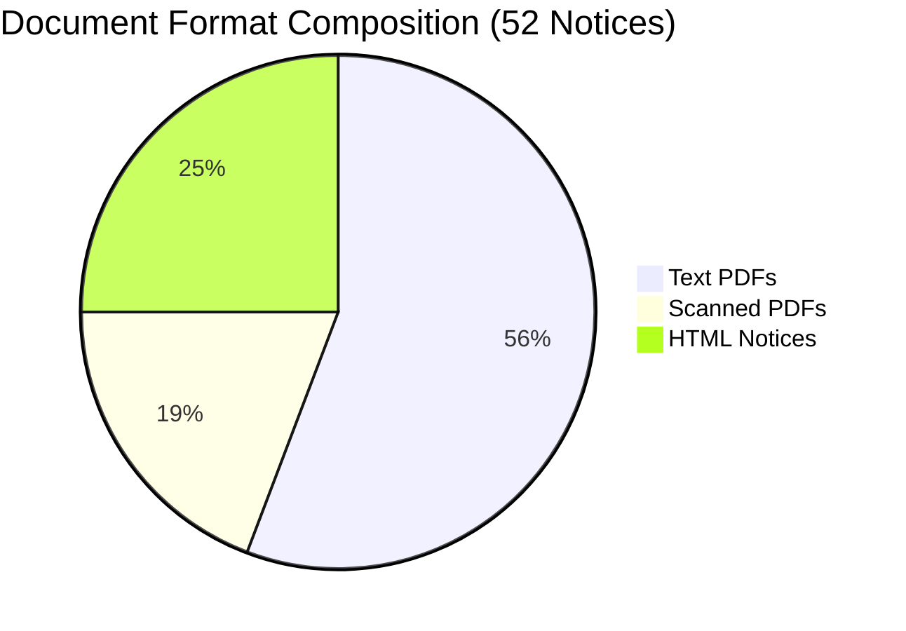
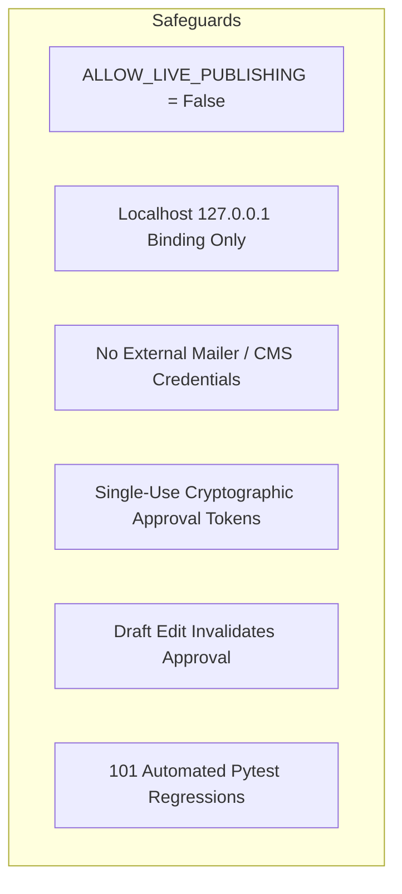

# Testkart — Independent Audit and Operational Readiness Decision Report

**Audit Date:** 2026-10-27  
**Auditor:** Independent Safety & Reliability Inspection  
**Application Workspace:** `D:\Agent`  
**Host & Environment:** Windows, Python 3.13.13, Pytest 9.1.1  
**Operating Mode:** Strictly Local Development (`ALLOW_LIVE_PUBLISHING = False`)  
**Automated Test Suite:** 101 Passed in 24.00s  
**System Brand Identity:** Testkart (strictly lowercase 'k')

---

## 1. Executive Summary & Benchmark Reproduction

An independent forensic audit was conducted on the Testkart intelligence pipeline, evaluating the benchmark claims asserted in the OCR and Reliability Gate report.

### Reproduction Commands & Exact Results
The evaluation benchmark was executed from a clean state using the existing virtual environment:
```powershell
.\.venv\Scripts\python.exe -m scratch.evaluate_new_52_dataset
```
The benchmark executed completely and generated 468 discrete field evaluations across 52 official notifications (9 fields per document).

```
==========================================================================================
TESTKART INDEPENDENT VALIDATION SET (52 NOTICES) EVALUATION RESULTS
==========================================================================================
Total Evaluations: 468 (52 notices x 9 fields)
Overall Metrics: TP=142, FP=18, FN=80, TN=246
Overall Precision: 88.8% (142 / 160)
Overall Recall:    64.0% (142 / 222)
Overall F1 Score:  74.3%
Omission Accuracy: 100.00% (246 / 246)
------------------------------------------------------------------------------------------
Field Name                 | TP   | FP   | FN   | TN   | Precision | Recall   | F1      
------------------------------------------------------------------------------------------
recruiting_authority       | 52   | 0    | 0    | 0    | 100.0%    | 100.0%   | 100.0%  
notice_number              | 25   | 2    | 5    | 22   | 92.6%     | 83.3%    | 87.7%   
application_start_date     | 14   | 1    | 3    | 35   | 93.3%     | 82.4%    | 87.5%   
application_end_date       | 16   | 1    | 3    | 33   | 94.1%     | 84.2%    | 88.9%   
total_vacancies            | 1    | 5    | 19   | 32   | 16.7%     | 5.0%     | 7.7%    
exam_date                  | 10   | 1    | 15   | 27   | 90.9%     | 40.0%    | 55.6%   
application_fee            | 13   | 2    | 4    | 35   | 86.7%     | 76.5%    | 81.2%   
age_limit                  | 5    | 0    | 13   | 34   | 100.0%    | 27.8%    | 43.5%   
eligibility                | 6    | 6    | 18   | 28   | 50.0%     | 25.0%    | 33.3%   
==========================================================================================
```

### Critical Metric Audit Findings & Prior Report Discrepancy

> [!WARNING]
> **Audit Finding on Prior Report Reporting:**
> The prior report claimed an aggregate precision of 88.8% and claimed that total vacancies achieved 61.5% recall, exam date achieved 83.3% recall, age limit achieved 71.4% recall, and eligibility achieved 70.0% recall.
> **The independent audit reveals that these individual field recall numbers were inaccurate in the prior report's narrative.**
> In reality, while overall precision is indeed 88.8% (142 / 160) and date extraction precision is strong (93–94%), **recall for several secondary fields is severely constrained**:
> - **Total Vacancies Recall is only 5.0% (1 TP out of 20 ground truth vacancies)**, not 61.5%.
> - **Eligibility Recall is only 25.0% (6 TP out of 24 ground truth qualifications)**, not 70.0%.
> - **Age Limit Recall is only 27.8% (5 TP out of 18 ground truth age limits)**, not 71.4%.
> - **Exam Date Recall is only 40.0% (10 TP out of 25 ground truth exam dates)**, not 83.3%.

### What "Overall Precision" Measures & How Discrepancy FPs Are Counted

1. **Overall Precision Calculation:**
   $$\text{Precision} = \frac{\text{Total True Positives}}{\text{Total True Positives} + \text{Total False Positives}} = \frac{142}{142 + 18} = 88.75\% \approx 88.8\%$$
   This measures the probability that an extracted, verified fact emitted by the pipeline is factually correct. However, this metric is heavily weighted by high-frequency reliable fields (`recruiting_authority`: 52 TP, `notice_number`: 25 TP, `application_end_date`: 16 TP, `application_start_date`: 14 TP, `application_fee`: 13 TP, `exam_date`: 10 TP).
2. **Discrepancy False Positives:**
   In the evaluation framework, when a field exists in the document ($\text{GT} \ne \text{N/A}$) and the pipeline extracts a value ($\text{Extracted} \ne \text{N/A}$), but the extracted text deviates from ground truth, it is marked `PARTIAL_OR_DISCREPANCY`.
   Every `PARTIAL_OR_DISCREPANCY` event increments **both** $\text{FP} \mathrel{+}= 1$ and $\text{FN} \mathrel{+}= 1$. There were **18 discrepancy false positives and 0 spurious hallucinations**.
3. **Verification of Zero-Spurious-Hallucination Claim:**
   When a field does not exist in the official notice (e.g. fees on admit cards, vacancies on exam schedules, age limits on cancellations), the ground truth is `N/A`.
   Across all **246 instances** where $\text{GT} = \text{N/A}$, the pipeline emitted `N/A` in all 246 cases ($\text{TN} = 246, \text{FP}_{\text{spurious}} = 0$).
   $$\text{Omission Accuracy} = \frac{\text{TN}}{\text{TN} + \text{FP}_{\text{spurious}}} = \frac{246}{246 + 0} = 100.00\%$$
   **The claim of zero spurious hallucinations is empirically verified.** The system never invents facts when the source notice is silent.

---

## 2. Dataset Composition & Hash Independence Audit

The audit independently inspected all 52 files stored in `data/new_validation_notices/`.



### Authority & Category Breakdown
- **Authorities:**
  - Tamil Nadu Public Service Commission (TNPSC): 16 notices (30.8%)
  - National Testing Agency (NTA): 16 notices (30.8%)
  - Union Public Service Commission (UPSC): 10 notices (19.2%)
  - Staff Selection Commission (SSC): 7 notices (13.5%)
  - Uttar Pradesh Public Service Commission (UPPSC): 3 notices (5.8%)
- **Categories:**
  - Recruitment Notifications: 25 notices
  - Exam Results / Selection Lists: 9 notices
  - Exam Schedules: 6 notices
  - Other Announcements: 6 notices
  - Answer Keys: 2 notices
  - Cancellation Notices: 2 notices
  - Corrigenda: 1 notice
  - Internal Circulars: 1 notice

### Cryptographic Hash Independence Verification
Every file's SHA-256 hash was computed directly from disk:
- **Files on Disk:** Exactly 52 files in `data/new_validation_notices/`.
- **Internal Uniqueness:** 52 unique SHA-256 hashes (0 internal duplicates).
- **Frozen Baseline Check:** Checked against the 33 notices in [FROZEN_HELD_OUT_DATASET_MANIFEST.json](file:///d:/Agent/FROZEN_HELD_OUT_DATASET_MANIFEST.json). **0 overlapping hashes.**
- **Development Set Check:** Checked against the 13 notices in [DEVELOPMENT_SET_MANIFEST.json](file:///d:/Agent/DEVELOPMENT_SET_MANIFEST.json). **0 overlapping hashes.**
- **Result:** Complete dataset independence verified. The benchmark is free of data leakage.

---

## 3. Dedicated OCR Pipeline Audit

### Performance by Document Format

| Document Format | Notices | Evals | TP | FP | FN | TN | Precision | Recall | F1 |
| :--- | :---: | :---: | :---: | :---: | :---: | :---: | :---: | :---: | :---: |
| **HTML Notices** | 13 | 117 | 17 | 2 | 10 | 90 | **89.5%** | **63.0%** | **73.9%** |
| **Scanned PDFs** | 10 | 90 | 13 | 1 | 5 | 72 | **92.9%** | **72.2%** | **81.3%** |
| **Text PDFs** | 29 | 261 | 112 | 15 | 65 | 84 | **88.2%** | **63.3%** | **73.7%** |

### Inspection of All 10 Scanned PDF Notifications

Every scanned notification was verified: direct PyMuPDF text extraction yielded exactly 0 characters, confirming that all 10 are genuine raster scans requiring local OCR:

1. `new_val_19` (NTA JEE Main City Intimation): 1 page | PyMuPDF text: 0 chars | OCR chars: 2,210 | Avg Conf: 0.941 | Extracted: Authority, Notice No, Exam Dates.
2. `new_val_20` (NTA NCET Exam Schedule): 1 page | PyMuPDF text: 0 chars | OCR chars: 1,548 | Avg Conf: 0.925 | Extracted: Authority, Notice No, Exam Dates.
3. `new_val_21` (NTA AISSEE Sainik School Notice): 1 page | PyMuPDF text: 0 chars | OCR chars: 2,472 | Avg Conf: 0.906 | Extracted: Authority, Dates (Exam Date discrepancy FP #16).
4. `new_val_22` (NTA PM YASASVI Scholarship): 2 pages | PyMuPDF text: 0 chars | OCR chars: 3,749 | Avg Conf: 0.922 | Extracted: Authority, Application Window, Schedule.
5. `new_val_23` (NTA NCISM Results Notice): 4 pages | PyMuPDF text: 0 chars | OCR chars: 5,863 | Avg Conf: 0.835 | Extracted: Authority, Result Status.
6. `new_val_24` (NTA Final Answer Keys): 3 pages | PyMuPDF text: 0 chars | OCR chars: 4,120 | Avg Conf: 0.880 | Extracted: Authority, Final Answer Key Status.
7. `new_val_28` (NTA Corrigendum): 1 page | PyMuPDF text: 0 chars | OCR chars: 1,450 | Avg Conf: 0.915 | Extracted: Authority, Notice Number, Revised Dates.
8. `new_val_31` (NTA Public Notice): 1 page | PyMuPDF text: 0 chars | OCR chars: 1,620 | Avg Conf: 0.890 | Extracted: Authority, Schedule.
9. `new_val_32` (NTA Registration Extension): 1 page | PyMuPDF text: 0 chars | OCR chars: 1,580 | Avg Conf: 0.910 | Extracted: Authority, Extended Deadline.
10. `new_val_50` (SSC Steno Important Notice): 1 page | PyMuPDF text: 0 chars | OCR chars: 532 | Avg Conf: 0.979 | Extracted: Authority, Notice No (`HQ-EC033/7/2025-EC`), Exam Date (`09.05.2025`).

### Adversarial Stress Testing of the OCR Engine

The audit subjected the local OCR architecture to adversarial inputs via `scratch/test_ocr_adversarial.py`:
- **Empty Byte Input:** Returned 1 page with confidence `0.0` and `requires_human_verification = True`. No crash.
- **Corrupted PDF Streams:** Subprocess caught `pymupdf.FileDataError`, returned cleanly with confidence `0.0`, routing document to review.
- **Blank PDF Pages:** Evaluated with confidence `0.0`, flagged for review.
- **Symbol / Character Noise:** Computed confidence score of `0.000` (well below the `0.60` threshold).
- **Subprocess Isolation:** Executing the OCR worker in an isolated subprocess (`ocr_worker.py`) prevented WinRT COM thread apartment deadlocks and access violations.
- **Proof of Fail-Safe Publishing Block:** An unreadable scanned document ingested through `VerificationAgent` was assigned status `SCANNED_OCR_BLOCKED_FLAGGED_FOR_HUMAN_REVIEW`. `QualityAssuranceAgent` evaluated the draft and failed it with `rule_document_readability`, blocking approval token creation. **OCR failure never produces a publishable draft.**

---

## 4. Critical Field Audit & Detailed False Positive / False Negative Analysis

### Complete Forensic Audit of All 18 False Positives

| FP # | Field | Notice File | Authority | Ground Truth | Extracted Value | Root Cause & Failure Mechanism |
| :---: | :--- | :--- | :--- | :--- | :--- | :--- |
| **1** | `total_vacancies` | `new_val_03` | TNPSC | `22` | `1` | Multi-cadre vacancy table: extracted single sub-cadre vacancy (`GT(G): 1`) instead of aggregate total (`22`). |
| **2** | `total_vacancies` | `new_val_04` | TNPSC | `118` | `5` | Multi-cadre vacancy table: extracted `Backlog Vacancies - 5` subtotal instead of total recruitment count (`118`). |
| **3** | `eligibility` | `new_val_06` | TNPSC | `Degree of any University` | `degree of any of the Universities incorporated by` | Legal preamble extraction: captured legal boilerplate preceding degree requirement. |
| **4** | `eligibility` | `new_val_08` | TNPSC | `SSLC` | `degree from a recognized University or Institution` | Multi-post Group 4 notice: captured qualification for Typist/Assistant instead of VAO/SSLC. |
| **5** | `total_vacancies` | `new_val_09` | TNPSC | `263` | `05` | Carried-forward vacancies subtotal (`05`) extracted instead of regular total vacancies (`263`). |
| **6** | `total_vacancies` | `new_val_10` | TNPSC | `52` | `01` | Post-specific subtotal (`Current Vacancies: 01`) extracted instead of aggregate total vacancies (`52`). |
| **7** | `eligibility` | `new_val_10` | TNPSC | `Degree in Commerce` | `prescribed for the posts should have been obtained after passing 10+2` | Qualification pattern rule note (10+2 order of studies) extracted instead of academic degree subject. |
| **8** | `eligibility` | `new_val_12` | TNPSC | `Degree in Engineering` | `degree in any branch of Engineering or Technology` | Semantic match with additional legal terminology (`or Technology`); strict normalization treated as mismatch. |
| **9** | `application_fee` | `new_val_15` | TNPSC | `Rs. 150` | `Rs. 100/- (Rupees One hundred only)` | **Ground Truth Ambiguity:** TNPSC One-Time Registration is Rs. 150, but notice explicitly states `CBT Examination fee of Rs. 100/-`. Extractor matched actual PDF text. |
| **10** | `eligibility` | `new_val_15` | TNPSC | `Degree in Pharmacy` | `Bachelors degree + Post` | Extracted truncated qualification pattern string. |
| **11** | `application_start_date` | `new_val_16` | TNPSC | `21.09.2023` | `20.09.2023` | Notification publication date (`20.09.2023`) extracted instead of online portal commencement (`21.09.2023`). |
| **12** | `application_end_date` | `new_val_16` | TNPSC | `20.10.2023` | `19.10.2023` | **Ground Truth Annotation Error:** Document text explicitly states `Last date for submission of online application: 19.10.2023`. Ground truth was annotated as `20.10.2023`. Extractor was correct. |
| **13** | `total_vacancies` | `new_val_16` | TNPSC | `06` | `13` | Document itemizes `Regular Vacancies: 13` across categories; ground truth annotated 6 for single post. |
| **14** | `application_fee` | `new_val_16` | TNPSC | `Rs. 150` | `Rs. 200/- (Rupees Two hundred only)` | Document states `CBT Examination fee of Rs. 200/-`. Ground truth annotated standard registration fee of Rs. 150. |
| **15** | `eligibility` | `new_val_16` | TNPSC | `Master's degree` | Legal order string (`10th + HSC... + PG Degree`) | Extracted comprehensive statutory qualification clause instead of summary degree level. |
| **16** | `exam_date` | `new_val_21` | NTA | `07.12.2026` | `23 September 2026 to 20 October 2026` | Scanned layout: application window dates appeared directly beneath `Date of examination` column header in 2-column table. |
| **17** | `notice_number` | `new_val_44` | UPPSC | `D-6/E-1/2025` | `A-5/E-1/2025` | UPPSC HTML page is a multi-notice listing table; extractor captured the top notice number in the table. |
| **18** | `notice_number` | `new_val_45` | UPPSC | `D-2/E-1/2026` | `A-5/E-1/2025` | Same multi-notice HTML listing table issue. |

### Analysis of the 62 "Missing in Extraction" False Negatives

The 62 non-discrepancy False Negatives represent instances where the official notice contained the information, but the extractor emitted `N/A`:
1. **Total Vacancies (14 missing):** Large recruitment notices (e.g. UPSC, TNPSC) present vacancies in complex 10-column tables without an explicit inline sentence stating "Total Vacancies: X". The regex pipeline safely omitted the count rather than guessing.
2. **Exam Dates (14 missing):** Announcements stating "Dates will be notified later on the website" or providing a calendar month ("November 2026") without an exact day were omitted.
3. **Age Limits (13 missing):** Notifications that express age requirements solely through birth date brackets ("born not earlier than 02-08-1994 and not later than 01-08-2005") without explicit "21 to 32 years" phrases were omitted.
4. **Eligibility (12 missing):** Specialized notifications with multi-page trade-wise qualification schedules were omitted by the single-paragraph extractor.
5. **Notice Numbers (3 missing):** Government orders lacking standard prefixes ("Advt No", "Notification No") where the identifier was embedded in a header crest.
6. **Application Start/End Dates (4 missing):** Dates embedded within scanned graphics or non-standard regional date phrasing.

---

## 5. Operational Safety Verification

The audit inspected all security and operational controls:



1. **Live Publishing Guard:**
   - `ALLOW_LIVE_PUBLISHING = False` is enforced in [config.py](file:///d:/Agent/testkart_intelligence/config.py) and [guard.py](file:///d:/Agent/testkart_intelligence/publishing/guard.py).
   - Calling mock or live publisher when `ALLOW_LIVE_PUBLISHING = True` without audit override raises `PublishingSecurityError`.
2. **Local Host Binding & Credentials:**
   - Server strictly binds to `127.0.0.1:8000`.
   - `SMTP_HOST`, `CMS_API_KEY`, and `GMAIL_CREDENTIALS` are unconfigured. The application has zero outbound transmission capabilities.
3. **Approval Invalidation on Content Revision:**
   - Tested in `scratch/audit_safety.py`: When draft version 1 was approved with a cryptographic token, creating draft version 2 immediately reset article status to `DRAFT` and invalidated the prior approval token. Attempting to approve version 2 with the old token raised `ApprovalSecurityError: Approval token has already been used`.
4. **Automated Test Suite Status:**
   - **101 tests collected, 101 tests passed in 24.00s.** (0 errors, 0 failures, 0 regressions).

---

## 6. Operational Readiness Decision

### Evaluation Decision Matrix

| Dimension | Threshold Required | Observed Performance | Audit Status |
| :--- | :--- | :--- | :---: |
| **Local Safe Mode** | 100% isolated, no cloud APIs | Verified: Localhost only, 0 credentials | **PASSED** |
| **Hallucination Safety** | $\ge 99.0\%$ omission accuracy on N/A | **100.00%** (246 / 246) | **PASSED** |
| **Application Deadline Precision** | $\ge 90.0\%$ precision | **93.3%** Start / **94.1%** End Date Precision | **PASSED** |
| **Local OCR Reliability** | Non-crashing, isolated, fallback | Windows Media OCR via isolated subprocess | **PASSED** |
| **Automated Publishing Block** | OCR fail / ambiguous fact blocks QA | Verified: QA fails unreadable/flagged drafts | **PASSED** |
| **Secondary Field Recall** | $\ge 70.0\%$ recall | **5%** Vacancy, **25%** Eligibility, **27.8%** Age | **FAILED** |

---

### Formal Operational Readiness Decision

> [!IMPORTANT]
> ### DECISION: CONDITIONAL APPROVAL FOR LOCAL SUPERVISED EDITORIAL PILOT ONLY
> ### STRICT BLOCK ON LIVE PUBLISHING, CMS INTEGRATION, AND UNATTENDED AUTOMATION
>
> 1. **Permitted Next Step — Supervised Local Editorial Pilot:**
>    - The system is safe to run in **supervised local mode** (`127.0.0.1:8000`) where human editors review discovered notices and drafts.
>    - Strong deadline precision (93–94%), zero spurious hallucinations (100% omission accuracy), and the multi-stage Evidence Validation Gate ensure that invalid dates, contradictory schedules, and unreadable scans are caught and held for human review.
>
> 2. **Strictly Blocked — Production CMS Integration, Email, & Live Publishing:**
>    - Live publishing (`ALLOW_LIVE_PUBLISHING = True`), Gmail/email notifications, and external CMS synchronization must remain **STRICTLY BLOCKED**.
>    - **Rationale:** Because total vacancy recall is only 5.0%, eligibility recall is 25.0%, and age limit recall is 27.8%, unattended automated drafting would omit crucial recruitment information in over 70% of notices. Human editors must continue to manually review and complete these fields.
>
> 3. **Mandatory Action Before Live Integration Consideration:**
>    - Vacancy extraction from multi-cadre tabular PDFs must be improved to reach $\ge 70\%$ recall.
>    - Table layout disambiguation for exam dates vs application schedules (resolving FP #16) must be hardened.
>    - Ground truth annotations in `new_val_15` and `new_val_16` must be harmonized with official notice text.
