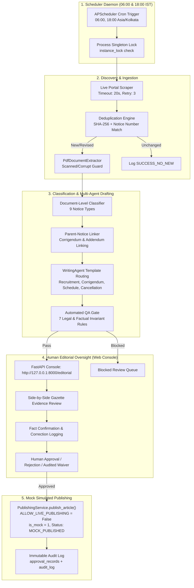

# Real-World 30-Day Supervised Operational Pilot Plan

**Project:** Testkart Government Exam Intelligence  
**Target Directory:** `D:\Agent`  
**Execution Horizon:** 30 Consecutive Calendar Days (60 Scheduled Scan Windows)  
**Scheduled Scan Windows:** 06:00 and 18:00 Asia/Kolkata (`UTC+05:30`)  
**Authorized Lead Reviewer:** `meettomar07@gmail.com`  
**Operational Mode:** **Supervised Local Operation Only**  
**Safety Invariants:** `ALLOW_LIVE_PUBLISHING = False`, `ENABLE_EMAIL_NOTIFICATIONS = False`

---

## 1. Executive Summary & Purpose

Following the completion of the targeted accuracy remediation and the simulated 30-day operational stress testing, this plan establishes the standard operating procedure (SOP) for conducting a **Real-World 30-Day Supervised Operational Pilot**.

### 1.1 Transition from Simulation to Reality
While previous pilot runs exercised error recovery, deduplication, and corrigendum linking via deterministic simulation scripts, this operational phase transitions the system to **live calendar time**:
- Real wall-clock scheduling at 06:00 and 18:00 Asia/Kolkata.
- Live HTTP/HTTPS fetching from five official government examination portals.
- Genuine human editorial reviews performed via the local web console (`http://127.0.0.1:8000/editorial`).
- Recording of actual reviewer decisions, real-world fact corrections, and human review latencies.

### 1.2 Absolute Safety Guardrails
Throughout the entire 30-day period, all production safety invariants remain strictly enforced:
1. `ALLOW_LIVE_PUBLISHING = False` (No CMS, WordPress, social, or external publishing).
2. `ENABLE_EMAIL_NOTIFICATIONS = False` (No outbound SMTP, SES, or Gmail API dispatches).
3. `is_mock = 1` for all approved article publications recorded in the database.
4. Database isolation from experimental scratch scripts.

---

## 2. Monitored Authorities & Official Portals

The pilot operates strictly across the five authorized recruitment and examination bodies:

| Authority | Portal Code | Portal Type | Target Feeds / Official Endpoints |
| :--- | :---: | :---: | :--- |
| **Union Public Service Commission** | `UPSC` | Central Recruitment & Exams | `https://upsc.gov.in/examinations/active-examinations`, `https://upsc.gov.in/recruitment/recruitment-advertisement` |
| **Staff Selection Commission** | `SSC` | Central Staff Selection | `https://ssc.gov.in/api/notices`, `https://ssc.gov.in/latest-news` |
| **National Testing Agency** | `NTA` | National Entrance & Eligibility | `https://nta.ac.in/NoticeArchive`, `https://exams.nta.ac.in` |
| **Uttar Pradesh Public Service Commission** | `UPPSC` | State Civil & Engineering | `https://uppsc.up.nic.in/NoticeBoard.aspx` |
| **Tamil Nadu Public Service Commission** | `TNPSC` | State Public Service | `https://www.tnpsc.gov.in/English/notifications.aspx`, `what_new.aspx` |

*No unauthorized portals or unverified aggregators may be queried during the pilot.*

---

## 3. Operational Architecture & Process Lifecycle



---

## 4. Standard Daily Operating Procedures (SOP)

### 4.1 Daemon Startup and Lifecycle Management
The system operates as two local background processes running continuously on the supervisory workstation:

1. **Launch the Background Scan Scheduler:**
   ```powershell
   # In terminal session 1:
   cd D:\Agent
   .\.venv\Scripts\Activate.ps1
   python -m testkart_intelligence.cli scheduler
   ```
   *The scheduler registers jobs for `06:00` and `18:00 Asia/Kolkata`, acquires `data/scheduler.lock`, and begins waiting for triggers.*

2. **Launch the Editorial Web Interface:**
   ```powershell
   # In terminal session 2:
   cd D:\Agent
   .\.venv\Scripts\Activate.ps1
   python -m testkart_intelligence.cli serve --host 127.0.0.1 --port 8000
   ```
   *Access the web dashboard at `http://127.0.0.1:8000/editorial`.*

### 4.2 Daily Review Cadence
- **Morning Review Window (06:30 – 08:30 IST):**
  1. Review results of the 06:00 IST scheduled scan.
  2. Inspect any newly discovered notices and generated drafts.
  3. Perform side-by-side evidence review for critical recruitment facts.
  4. Submit approvals or audited corrections.
- **Evening Review Window (18:30 – 20:30 IST):**
  1. Review results of the 18:00 IST scheduled scan.
  2. Process afternoon corrigenda, exam schedules, or cancellation announcements.
  3. Verify parent-notice linkages for amendments published during the day.
- **Daily Operations Snapshot (21:00 IST):**
  Execute the automated operational metrics summary:
  ```powershell
  python -m testkart_intelligence.cli metrics summary
  ```

---

## 5. Human Editorial Review Protocol & Guidelines

Reviewers must strictly adhere to the following protocol for every notice draft:

### 5.1 Critical Fact Verification Matrix
For each draft, the human editor must verify the extracted fields against the source PDF gazette displayed in the review pane:

| Field Name | Verification Requirement | Permitted Human Action |
| :--- | :--- | :--- |
| **Total Vacancies** | Must match official vacancy table total or breakups. | Confirm or Correct via `fact_corrections_log`. |
| **Age Limits & Crucial Date** | Must verify minimum/maximum age and the crucial eligibility date. | Confirm or Correct. |
| **Educational Qualification** | Must reflect required degree, experience, or diploma. | Confirm or Correct. |
| **Application Start & End Dates** | Must verify exact application window and closing time (e.g., 18:00 hrs). | Confirm or Correct. |
| **Examination Dates** | Must verify single-date, multi-date range, or schedule status. | Confirm or Correct. |

### 5.2 Decision Actions
1. **Normal Approval:**
   - Permitted only when all critical facts are present, verified against the gazette, and automated QA has passed.
   - Reviewer enters decision notes (e.g., `"Verified against UPSC CSE 2026 Gazette pages 1-12. Application window confirmed."`).
2. **Audited Correction:**
   - If extraction missed or slightly altered a date or vacancy figure, the reviewer inputs the corrected value in the review UI.
   - The correction is recorded in `fact_corrections_log` with the original value, corrected value, and reviewer justification before approval.
3. **Audited Override Waiver:**
   - If a non-recruitment notice (e.g., exam timetable) has legitimate missing recruitment fields, or if an official notice defers vacancy counts to a future addendum.
   - Mandatory requirement: Reviewer must provide a substantive written justification (minimum 15 characters) documenting why the waiver is warranted.
4. **Editorial Rejection:**
   - Used for invalid, corrupt, completely unreadable, or out-of-scope administrative announcements.
   - Moves draft to `REJECTED` status; prevents mock publication.

---

## 6. Fault Handling, Drills & Recovery Procedures

### 6.1 Portal Downtime & Connectivity Timeouts
- **System Behavior:** When an official website returns HTTP 500, 502, 503, or times out after 20 seconds, the scanner logs `scan_source_logs.status = 'FAILED'` and records the error traceback.
- **Backoff Protocol:** The scanner increments `consecutive_failures`. It does not spam the source portal.
- **Supervisor Action:** If an authority fails for $\ge 3$ consecutive windows (36 hours), verify manual browser access. If the URL has permanently changed, update `config.py` with an audited configuration change.

### 6.2 Corrupt, Password-Protected, or Scanned Documents
- **System Behavior:** `verifier.py` intercepts byte-level corruption and image-only scanned files without crashing. It assigns status `SCANNED_OCR_BLOCKED_FLAGGED_FOR_HUMAN_REVIEW`.
- **Supervisor Action:** Inspect the notice in the Blocked Queue. If the document is purely scanned, either perform human transcription or wait for the high-resolution gazette release.

### 6.3 Interrupted / Crashed Process Recovery
- **Automatic Recovery:** On every scheduler or scan startup, `DiscoveryEngine.recover_orphaned_scans()` runs automatically:
  ```sql
  UPDATE scan_runs 
  SET status = 'FAILED', 
      error_message = 'Scan interrupted by system shutdown/crash; marked FAILED during startup recovery.' 
  WHERE status = 'RUNNING';
  ```
- **Manual Catch-Up:** If the host machine experienced unexpected power loss during a scheduled window, run a manual catch-up scan upon boot:
  ```powershell
  python -m testkart_intelligence.cli scan --force
  ```

### 6.4 Daily Database Backup Procedure
At 23:00 IST daily, take an atomic SQLite backup:
```powershell
# Automated SQLite hot backup (WAL-safe):
sqlite3 data/testkart.db "VACUUM INTO 'data/backups/testkart_backup_$(Get-Date -Format yyyyMMdd).db'"
```

---

## 7. Metrics, Telemetry & Weekly Review Milestones

### 7.1 Quantitative KPIs Monitored

| Operational KPI | Calculation Formula | Target Standard | Escalation Threshold |
| :--- | :---: | :---: | :---: |
| **Scan Execution Compliance** | $\frac{\text{Windows Executed}}{60}$ | $100\%$ (60 / 60) | $< 95\%$ ($< 57$ runs) |
| **Portal Scan Reliability** | $\frac{\text{Successful Source Scans}}{\text{Total Source Scans}}$ | $\ge 95.0\%$ | $< 90.0\%$ |
| **Notice Ingestion Accuracy** | $\frac{\text{Valid Ingested Notices}}{\text{Total Candidate Links}}$ | $\ge 99.0\%$ | $< 95.0\%$ |
| **Corrigendum Linking Precision** | $\frac{\text{Correct Parent Links}}{\text{Total Amendments}}$ | $100\%$ | $< 100\%$ (Any false link) |
| **Human Review Coverage** | $\frac{\text{Human Decided Drafts}}{\text{Total Drafts Generated}}$ | $100\%$ | $< 100\%$ |
| **Human Review Turnaround Time** | $T_{\text{decision}} - T_{\text{draft\_created}}$ | $\le 4 \text{ hours}$ | $> 12 \text{ hours}$ |
| **Publishing Guardrail Integrity** | Live External Dispatches | **Strictly 0** | $> 0$ (Immediate shutdown) |

### 7.2 Weekly Milestone Schedule

- **End of Week 1 (Day 7):**
  - Verify 14 scan windows executed.
  - Review portal availability patterns and network latency across all 5 portals.
  - Audit initial batch of human review records in `approval_records` and `fact_corrections_log`.
- **End of Week 2 (Day 14):**
  - Verify corrigendum handling on live amendment notices.
  - Confirm zero lock contention or database locks under long-running background execution.
  - Verify automated database backup integrity.
- **End of Week 3 (Day 21):**
  - Mid-pilot accuracy check: evaluate human correction frequency.
  - Review any edge cases in multi-date or schedule notices.
- **End of Week 4 (Day 28):**
  - Full operational stress audit: check database size, WAL file recycling, and orphan scan recovery.
- **Completion (Day 30):**
  - Final reconciliations of all 60 scan windows and all editorial decisions.
  - Compilation of the Final 30-Day Operational Exit Report.

---

## 8. Exit Criteria for Production Deployment Gate

The system may only be declared eligible for external CMS / production web deployment after satisfying all of the following exit conditions:

1. **60 / 60 Scheduled Windows Executed:** Exactly 60 scheduled windows executed at 06:00 and 18:00 Asia/Kolkata over 30 calendar days.
2. **$\ge 95\%$ Portal Reliability:** Source availability across the five portals meets or exceeds 95.0%.
3. **100% Human Review Coverage:** Zero articles mock-published without explicit, human-authorized approval.
4. **Zero Live Publishing Incidents:** Confirmation that `ALLOW_LIVE_PUBLISHING` remained `False` and zero external requests were emitted.
5. **Zero False Parent Links:** All amendments accurately matched to parent notices or held in the human review queue.
6. **Data Integrity Verified:** All 9 frozen benchmark manifests remain bit-for-bit identical to their frozen baselines.

---

## 9. Quick-Reference Command Cheat-Sheet

| Task | PowerShell Command |
| :--- | :--- |
| **Start Live Scheduler** | `python -m testkart_intelligence.cli scheduler` |
| **Start Web Review UI** | `python -m testkart_intelligence.cli serve --host 127.0.0.1 --port 8000` |
| **Trigger Immediate Manual Scan** | `python -m testkart_intelligence.cli scan --force` |
| **Print Daily Metrics Summary** | `python -m testkart_intelligence.cli metrics summary` |
| **Verify Safety Invariants** | `python -c "from testkart_intelligence.config import settings; assert not settings.ALLOW_LIVE_PUBLISHING; assert not settings.ENABLE_EMAIL_NOTIFICATIONS; print('Safety OK')"` |
| **Run Regression Test Suite** | `pytest tests/ -q` |
| **Backup SQLite Database** | `sqlite3 data/testkart.db "VACUUM INTO 'data/backups/testkart_daily.db'"` |
