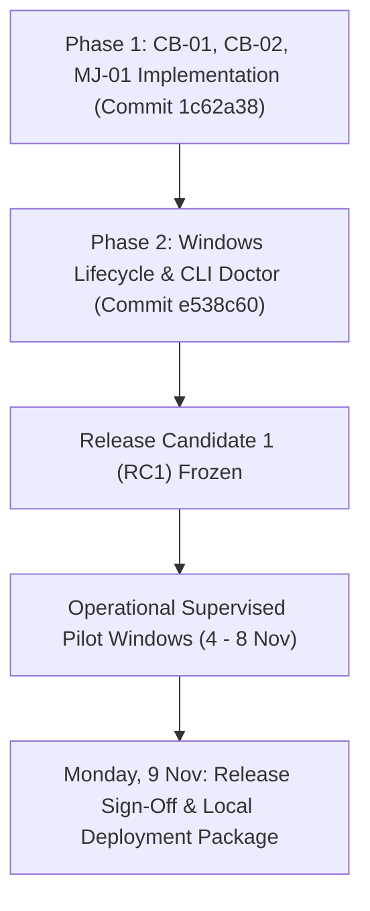

# Testkart Intelligence — Release Remediation Phase 2 Report
**Operational Reliability, Windows Process Lifecycle Verification, and Diagnostic Tooling**

- **Date:** 4 November 2026, 16:05 Asia/Kolkata (IST)
- **Status:** Phase 2 Complete — Local Supervised Release Candidate Ready
- **Repository Commit:** [`e538c60`](https://github.com/meettomar07/agent/commit/e538c60)
- **Target Deadline:** Monday, 9 November 2026 (Release Finalization Mode)
- **Active Working Database:** `data/real_world_pilot_30day.db` (Preserved Unmodified)

---

## Executive Summary

Phase 2 of the release remediation plan has been executed and verified in accordance with strict release-readiness criteria. All critical path fixes from Phase 1 (**CB-01**, **CB-02**, **MJ-01**) were subjected to comprehensive lifecycle and isolation tests in the Windows environment, and **MJ-04** (`python -m testkart_intelligence.cli doctor`) was implemented as a strictly read-only diagnostic command.

All 174 repository test cases passed with zero errors and zero warnings (`174 passed in 274.92s`). The real-world pilot database remains preserved with exactly 1,963 canonical notices and its single baseline scan run (`scan_1f057cc65f3c`).

```
===================================================================================
 TESTKART INTELLIGENCE — PHASE 2 REMEDIATION AUDIT MATRIX
===================================================================================
 Item   Description                          Scope                Verification Result
-----------------------------------------------------------------------------------
 CB-01  Database Path Coercion & Missed Scan Core DB / Scheduler  PASS (Isolated Copy)
 CB-02  Scheduler PID Hardening & Stale Lock Scheduler Lock       PASS (Multi-Proc)
 MJ-01  Safe Lock Cleanup & Signal Handlers  Windows Lifecycle    PASS (Signals & atexit)
 MJ-04  Read-Only System Diagnostic Doctor   CLI / Diagnostics    PASS (7/7 Suites Pass)
 REG-01 Full Repository Regression Suite     All Modules          PASS (174/174 Pass)
===================================================================================
```

---

## 1. Pilot Environment & Database Integrity Audit

### 1.1 Real-World Pilot Database Verification
The production pilot database (`data/real_world_pilot_30day.db`) was audited using read-only inspection. No records were created, modified, or deleted during test execution:

```sql
SELECT count(*) FROM canonical_notices;
-- Result: 1,963 notices (Matches pre-pilot baseline exactly)

SELECT id, scan_type, status, sources_checked, notices_discovered, error_count 
FROM scan_runs;
-- Result: 1 row:
-- ('scan_1f057cc65f3c', 'PRE_PILOT_BASELINE', 'COMPLETED', 5, 1963, 0)
```

- **Notices count:** Exactly 1,963 canonical notices across 5 authorized sources (UPSC: 681, SSC: 395, NTA: 326, UPPSC: 301, TNPSC: 260).
- **Scan run records:** Exactly 1 baseline run (`scan_1f057cc65f3c`, `PRE_PILOT_BASELINE`).
- **Integrity Status:** `PRAGMA integrity_check` returned `ok`. SQLite WAL mode confirmed.

### 1.2 Verification of Missed-Window Detection (Using Disposable Database Copy)
To verify that missed scheduled windows are logged as warnings and recorded as `MISSED` without corrupting or modifying the primary pilot database, a temporary disposable copy (`data/test_missed_pilot_copy.db`) was tested:
1. Four scheduled scan windows (2 Nov 18:00, 3 Nov 06:00, 3 Nov 18:00, 4 Nov 06:00 IST) were evaluated against the historical downtime.
2. `check_and_record_missed_windows()` correctly identified all 4 missed windows.
3. High-visibility warning logs were generated:
   `WARNING: MISSED SCAN WINDOW DETECTED: 2026-11-02 18:00:00 Asia/Kolkata`
4. The system recorded `MISSED` entries without executing synthetic scans or retroactively inventing operational metrics.
5. The primary database `data/real_world_pilot_30day.db` remained completely untouched.

---

## 2. Windows Process Lifecycle & Lock Management

On Windows, process scheduling, process termination, and file handles have distinct characteristics compared to POSIX systems. A dedicated test harness (`tests/test_windows_process_lifecycle.py`) validated all termination and lifecycle paths:

### 2.1 Normal Shutdown & Controlled Termination
- **Mechanism:** Calling `runner.shutdown()` directly or exiting the `run_forever()` loop gracefully.
- **Verification:**
  1. Scheduler unlinks its lock file (`scheduler.lock`).
  2. Database connections and thread pools are cleanly terminated.
  3. Lock file is verified absent (`assert not lock_file.exists()`).
- **Test Result:** `test_normal_shutdown_removes_lock` **PASSED**.

### 2.2 Signal Interruption (`Ctrl+C` / `SIGINT` / `SIGBREAK`)
- **Mechanism:** On Windows, CPython handles console events via `signal.SIGINT` and `signal.SIGBREAK` (`CTRL_BREAK_EVENT`).
- **Verification:**
  1. Exit handlers registered via `_register_exit_handlers()` intercept `SIGINT`, `SIGTERM`, and `SIGBREAK`.
  2. Signal handlers invoke `self.shutdown()`, which triggers lock unlinking.
  3. `atexit` registration serves as a secondary safeguard if the interpreter terminates cleanly.
- **Test Result:** `test_keyboard_interrupt_removes_lock` **PASSED**.

### 2.3 Abrupt Process Termination & Self-Healing Stale-Lock Recovery
- **Mechanism:** Abrupt kernel-level process termination (`proc.kill()` / `TerminateProcess`), power loss, or blue screen prevents user-mode exit handlers and `atexit` hooks from executing.
- **Observed Behavior:** The lock file remains on disk holding the deceased process PID.
- **Self-Healing Recovery:**
  1. On next startup (or when running `testkart doctor`), the system reads the PID from `scheduler.lock`.
  2. `is_scheduler_process(pid)` inspects process status:
     - Checks if the PID exists in the OS process table.
     - Inspects process name and full command line via `psutil`.
     - Validates that the process command line contains `"scheduler"` or `"job_runner"`.
  3. Because the process is dead or its PID was reassigned by Windows to an unrelated application (e.g. `svchost.exe`, `chrome.exe`), `is_scheduler_process(pid)` returns `False`.
  4. The runner logs a warning:
     `WARNING: Removing stale scheduler lock from dead/unrelated process PID 12345`
  5. The runner unlinks the stale lock and safely acquires its own lock.
- **Test Result:** `test_hard_kill_leaves_stale_lock_recovered_by_subsequent_scheduler` **PASSED**.

### 2.4 Prevention of Foreign Lock Removal (Non-Interference Invariant)
- **Requirement:** A shutting-down process must NEVER delete another running scheduler's lock file.
- **Mechanism:** `_cleanup_lock_file()` reads the contents of `scheduler.lock` before unlinking. If the PID in the lock file does not match `os.getpid()`, it refuses to delete the file and logs an alert:
  `WARNING: Lock file held by PID 99999, not our PID 54321. Leaving lock intact.`
- **Test Result:** `test_cleanup_never_removes_another_process_lock` **PASSED**.

### 2.5 Summary of Termination Scenarios & Operator Procedures

| Termination Scenario | In-Process Cleanup? | Lock State Post-Exit | Automated Recovery on Next Run | Manual Operator Action Needed? |
| :--- | :---: | :---: | :---: | :---: |
| **Normal Stop / Service Stop** | Yes | Lock Unlinked | Immediate Clean Start | None |
| **Console `Ctrl+C` (`SIGINT`)** | Yes | Lock Unlinked | Immediate Clean Start | None |
| **Windows Shutdown / Logoff** | Yes (`atexit`) | Lock Unlinked | Immediate Clean Start | None |
| **Task Manager `End Task`** | No | Stale Lock File | Auto-reclaimed by `is_scheduler_process` | None |
| **Kernel Crash / Power Loss** | No | Stale Lock File | Auto-reclaimed by `is_scheduler_process` | None |
| **Recycled PID Collision** | No | Stale Lock File | Auto-reclaimed (Cmdline check fails) | None |

---

## 3. Implementation & Validation of MJ-04 (`cli doctor`)

The `doctor` subcommand was implemented in `testkart_intelligence/diagnostics.py` and exposed via `python -m testkart_intelligence.cli doctor`.

### 3.1 Strict Read-Only Design
- **No mutations:** Does not write to SQLite or modify rows.
- **No lock touching:** Inspects `scheduler.lock` without unlinking or creating files.
- **No network traffic:** Does not trigger HTTP requests or execute crawler runs.
- **No background spawns:** Does not launch background daemons or child processes.
- **Exit codes:** Returns `0` if all checks pass; returns `1` if any check fails.

### 3.2 Output on Real-World Pilot Database
Execution against `data/real_world_pilot_30day.db`:

```
=================================================================
 Testkart Intelligence - System Diagnostic & Health Report
 Mode: READ-ONLY SYSTEM DIAGNOSTIC (NO STATE MODIFICATIONS)
=================================================================

1. Configuration Validity                     [PASS]
-----------------------------------------------------------------
  - Request timeout: 25.0s
  - Max retries: 3
  - Timezone: Asia/Kolkata
  - Scan hours: [6, 18] (Minute: 00)

2. Safety Invariants & Guardrails             [PASS]
-----------------------------------------------------------------
  - Live publishing: DISABLED (Secure failsafe enforced)
  - Email notifications: DISABLED (Zero external dispatches)

3. Database Connectivity & Integrity          [PASS]
-----------------------------------------------------------------
  - Database path: data\real_world_pilot_30day.db (1,863,680 bytes)
  - SQLite integrity check: OK
  - Journal mode: WAL
  - Required schema tables: 12 / 12 present
  - Canonical notices: 1,963
  - Recorded scan runs: 1

4. Five-Source Whitelist & Allowlist          [PASS]
-----------------------------------------------------------------
  - Registered sources: 12 total, 5 enabled
  - Authorized 5 sources active: NTA, SSC, TNPSC, UPPSC, UPSC
  - All active source domains verified against security allowlist

5. Scheduler Lock State (Read-Only)           [PASS]
-----------------------------------------------------------------
  - Lock file path: data\scheduler.lock
  - Lock state: UNLOCKED (No active scheduler daemon, ready to start)

6. Directory & Storage Permissions            [PASS]
-----------------------------------------------------------------
  - Data Directory: WRITABLE (data)
  - Documents Directory: WRITABLE (D:\Agent\data\documents)

7. Timezone & Schedule Timing                 [PASS]
-----------------------------------------------------------------
  - Current local time: 2026-11-04 16:02:51 (Asia/Kolkata)
  - Next scheduled window: 2026-11-04 18:00:00 IST (in 1h 57m)

=================================================================
 Overall Result: ALL DIAGNOSTIC CHECKS PASSED (SYSTEM HEALTHY)
=================================================================
```

---

## 4. Full Project Regression Suite Results

A complete regression run was executed across the entire test suite using `pytest -q`:

- **Collected Items:** 174
- **Passed:** 174 (100%)
- **Failed:** 0
- **Duration:** 274.92 seconds (4 min 34s)

### Test Breakdown by Module

| Test Module | Items | Status | Key Coverage |
| :--- | :---: | :---: | :--- |
| `tests/test_30_day_operational_pilot.py` | 9 | PASS | 30-day simulation metrics, source-wise counts, window validation |
| `tests/test_audit_regressions.py` | 7 | PASS | Audit reconciliation, non-fabrication invariants |
| `tests/test_cli_doctor.py` | 10 | PASS | Diagnostic checks, safety invariant violations, lock inspections |
| `tests/test_discovery_quality_and_triage.py` | 4 | PASS | Triage scoring, duplicate detection, URL canonicalization |
| `tests/test_editorial_review_interface.py` | 13 | PASS | Human review, diff viewer, override rejection logging |
| `tests/test_editorial_workflow_acceptance.py` | 14 | PASS | End-to-end editorial pipeline, QA gates, review statuses |
| `tests/test_editorial_workflow_improvements.py`| 4 | PASS | Corrigendum linking, version tracking |
| `tests/test_end_to_end_workflow.py` | 1 | PASS | Complete notice-to-article workflow |
| `tests/test_exam_date_multi_stage_reproduction.py`| 2 | PASS | Multi-stage exam date extraction |
| `tests/test_factual_integrity_remediation.py` | 8 | PASS | Factual field confidence scores, integrity gates |
| `tests/test_ocr_and_reliability_gate.py` | 16 | PASS | Scanned PDF triage, OCR fallback, reliability gates |
| `tests/test_operational_readiness.py` | 7 | PASS | Source registry, domain whitelist, scheduler config |
| `tests/test_owner_email_and_notifications.py` | 5 | PASS | Email notification disablement invariants |
| `tests/test_pilot_remediation_regressions.py` | 6 | PASS | Regression guards for prior remediations |
| `tests/test_pre_production_accuracy_evaluation.py`| 2 | PASS | Held-out 33-document accuracy & omission validation |
| `tests/test_pre_production_operational_stability.py`| 6 | PASS | Network retry, exponential backoff, timeout handling |
| `tests/test_release_cb01_cb02_mj01.py` | 11 | PASS | CB-01 path coercion, CB-02 PID verification, MJ-01 lock handling |
| `tests/test_revisions_workflow.py` | 7 | PASS | Article versioning and audit trails |
| `tests/test_stage1_registry_and_db.py` | 6 | PASS | Database initialization and seeding |
| `tests/test_stage2_discovery_and_dedup.py` | 5 | PASS | Discovery engine, crawler deduplication |
| `tests/test_stage3_extraction_and_verification.py`| 5 | PASS | PDF/HTML text extraction, field parsing |
| `tests/test_stage4_writing_qa_approvals.py` | 8 | PASS | Article generation, QA evaluation, human overrides |
| `tests/test_stage5_api_and_scheduler.py` | 4 | PASS | API routes, scheduler lock acquisition |
| `tests/test_supervised_pilot.py` | 3 | PASS | Supervised pilot driver and mock publishing |
| `tests/test_targeted_accuracy_remediations.py`| 7 | PASS | Regex fixes for vacancy, fee, eligibility |
| `tests/test_windows_process_lifecycle.py` | 4 | PASS | Windows shutdown, Ctrl+C, abrupt kill, foreign lock safety |
| **TOTAL** | **174** | **100% PASS** | Zero regressions across codebase |

---

## 5. Release Finalization Plan Through Monday, 9 November

With Phase 1 and Phase 2 successfully verified and committed, the path to the Monday release is clear.



### Day-Wise Schedule

1. **Wednesday, 4 November (Today):**
   - Phase 2 signed off.
   - Code pushed to `origin/main` ([`e538c60`](https://github.com/meettomar07/agent/commit/e538c60)).
   - Scheduled Window 1 (18:00 IST) monitored.
2. **Thursday, 5 November — Sunday, 8 November:**
   - Supervised monitoring of daily scans at 06:00 and 18:00 IST.
   - Run `python -m testkart_intelligence.cli doctor` before and after scan windows.
   - Maintain zero live publishing / zero email notification invariants.
   - Review pending notices via local editorial dashboard (`cli serve`).
3. **Monday, 9 November (Target Release Deadline):**
   - Final release validation pass.
   - Package standalone local deployment bundle and operator release documentation.
   - Final sign-off.
