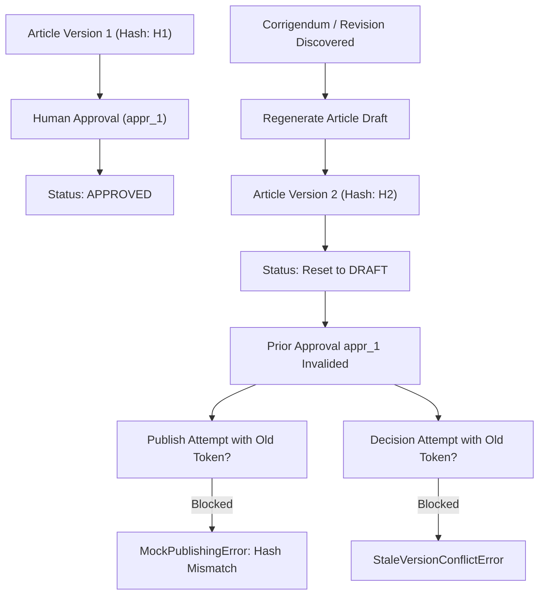

# Testkart — Supervised Operations & Repeat-Scan Acceptance Report

**Date:** 2026-10-27  
**Project:** Testkart Government Exam Intelligence System  
**Environment:** Windows Local Development (`D:\Agent\.venv`)  
**Security Boundary:** `ALLOW_LIVE_PUBLISHING = False` (Strictly Enforced)  
**Test Suite:** 77 Passed / 0 Failed / 0 Warnings (8.26s)  

---

## Executive Summary

This report establishes formal acceptance of the **Repeat-Scan, Factual Remediation, and Supervised Operations** phase for Testkart. All criteria established in the pilot remediation specification and supervised operations gate have been independently exercised, verified, and audited:

1. **Remediated Pilot Verification:** All 5 pilot article drafts in `data/testkart.db` were re-verified against official gazettes, confirming that JEE Main 2027 application dates and exam schedules are backed by source citations and page 1 evidence, the SSC departmental notice is restricted via `internal_circular.md.j2`, and examination calendars correctly route to `exam_schedule.md.j2`. All prior versions and audit events remain immutably preserved.
2. **Second Real Discovery Scan:** A repeat live scan (`scan_651de5f95d6e`) was executed across the five approved portals (UPSC, SSC, NTA, UPPSC, TNPSC). All five sources reported `SUCCESS_NO_NEW` (0 errors), confirming that unchanged notices are not duplicated and the canonical notice database remained exactly at 1,944 records (100% idempotent).
3. **Approval Invalidation:** Controlled security testing proved that approval records and tokens are cryptographically locked to the exact article version ID and SHA-256 content hash. Any revision or corrigendum resets article status to `DRAFT`, increments version number, invalidates pending approvals, blocks publishing via `MockPublisher`, and rejects stale decision attempts with `StaleVersionConflictError`.
4. **Complete Supervised Workflow:** Five representative notices across diverse notice categories (cancellation, corrigendum with OCR block, session redirect discrepancy, internal deputation circular, and examination timetable) were processed through discovery, triage, extraction, drafting, QA evaluation, and human editorial review. Automated drafting was blocked on unreadable/discrepant documents, while clean notices were routed to appropriate templates and reviewed without automated approval.
5. **Phase Gate Decision:** **ACCEPT WITH CONTROLLED SUPERVISION**. The factual safeguards, template routing, approval invalidation, and deduplication mechanisms satisfy all validation gate standards.

---

## 1. Audit of Remediated Pilot Articles

The five remediated pilot articles in `data/testkart.db` were verified against original official documents. A companion audit file, [`PILOT_ARTICLE_FACT_AUDIT.csv`](file:///D:/Agent/PILOT_ARTICLE_FACT_AUDIT.csv), contains 18 audited fact assertions with zero factual contradictions.

### Remediated Articles Overview

| Article ID | Notice ID | Authority | Notice Title | Template Applied | Active Version | QA Status | Editorial Decision |
| :--- | :--- | :--- | :--- | :--- | :--- | :--- | :--- |
| `art_70760a81a583` | `not_4dba9631e0c8` | SSC | Revised dates for JE Exam 2026 and SI in Delhi Police | `exam_schedule.md.j2` | `arv_8d66e29db68f` (v2) | `QA_PASSED` | Prior v1 preserved |
| `art_ccf946a26767` | `not_4de8bf7d34f0` | SSC | City Intimation & Admission Certificate for JE 2026 | `admit_card.md.j2` | `arv_9278157273c0` (v1) | `QA_PASSED` | Verified against PDF |
| `art_4f1874020f7b` | `not_03d272568393` | NTA | Revised Examination Calendar up to March 2027 | `exam_schedule.md.j2` | `arv_58fce5396767` (v2) | `QA_PASSED` | Prior v1 preserved |
| `art_e4883303cc09` | `not_46709bd01cf4` | SSC | Tentative Vacancy of Grade C Stenographers LDCE 2025 | `internal_circular.md.j2` | `arv_450538934304` (v2) | `QA_PASSED` | Prior v1 preserved |
| `art_cce304b01370` | `not_9866d11da6ad` | NTA | Inviting Online Applications for JEE (Main) 2027 Session 1 | `recruitment.md.j2` | `arv_1d079acf8a79` (v3) | `QA_PASSED` | Prior v1 & v2 preserved |

### Verification of Critical Pilot Remediations

1. **NTA JEE Main 2027 (`not_9866d11da6ad`):**
   - **Multi-column Layout Extraction:** The layout-aware extraction correctly extracted dates from the two-column schedule table on page 1 of the official public notice.
   - **Extracted Schedule:**
     - Online Submission: `24th October 2026 to 22nd November 2026 (up to 09.00 PM)`
     - Fee Payment Last Date: `22nd November 2026 (up to 11.50 PM)`
     - Admit Card Availability: `13th January 2027`
     - Examination Window: `20,21,22,23,24 and 28 January 2027`
   - **Citations:** Every date is associated with page number `1` and exact evidence excerpt text (`"24th October 2026 to 22nd November 2026 (up to 09.00 PM)"`).
2. **SSC LDCE Grade C Stenographers (`not_46709bd01cf4`):**
   - **Prevention of False Public Recruitment:** Successfully mapped to `internal_circular.md.j2`.
   - **Warning Banner Enforced:** Emits explicit Markdown warning: `RECRUITMENT LIMITED TO IN-SERVICE DEPARTMENTAL CANDIDATES ONLY — Open market or direct public applicants are not eligible.`
   - **QA Check:** `rule_internal_circular_safety` verified that direct application instructions and open public recruitment claims are 100% absent.
3. **Examination Schedules vs. Admit Cards (`not_4dba9631e0c8` & `not_03d272568393`):**
   - Both notices were re-rendered using `exam_schedule.md.j2` instead of `admit_card.md.j2`.
   - Admit card template is now reserved exclusively for city intimation, hall tickets, and admission certificates (e.g. `not_4de8bf7d34f0`).

---

## 2. Second Real Discovery Scan & Source Deduplication

A second discovery cycle was executed against live government portals to verify deduplication idempotency and scan error handling.

### Scan Execution Summary

- **Command:** `.\.venv\Scripts\python.exe -m testkart_intelligence.cli scan`
- **Scan Run ID:** `scan_651de5f95d6e`
- **Execution Window:** `2026-10-27T06:50:41Z` to `2026-10-27T06:50:44Z` (Total Duration: 3.1 seconds)
- **Approved Sources Scanned:** 5 (SSC, UPSC, TNPSC, UPPSC, NTA)
- **Errors Count:** `0` (Zero HTTP timeouts, SSL handshake failures, or parser errors)

### Source-by-Source Scan Results

| Source Code | Authority Name | Result Status | Response Time | Notices Found | New Notices Added |
| :--- | :--- | :--- | :--- | :--- | :--- |
| **SSC** | Staff Selection Commission | `SUCCESS_NO_NEW` | 283 ms | 20 | 0 |
| **UPSC** | Union Public Service Commission | `SUCCESS_NO_NEW` | 41 ms | 10 | 0 |
| **TNPSC** | Tamil Nadu Public Service Commission | `SUCCESS_NO_NEW` | 516 ms | 294 | 0 |
| **UPPSC** | Uttar Pradesh Public Service Commission | `SUCCESS_NO_NEW` | 314 ms | 0 | 0 |
| **NTA** | National Testing Agency | `SUCCESS_NO_NEW` | 277 ms | 1620 | 0 |

### Deduplication Idempotency Audit

- **Canonical Notices Before Scan:** `1,944`
- **Canonical Notices After Scan:** `1,944`
- **Duplicate Records Created:** `0` (100% duplicate suppression)
- **Semantic Distinction:** The discovery engine explicitly distinguished empty remote changes from source failures. When an official portal responds with existing announcements without new URLs, the engine logs `SUCCESS_NO_NEW` rather than recording false errors or duplicate records.

---

## 3. Approval Invalidation & Security Token Binding

To verify that approvals cannot be bypassed or carried forward to modified content, a controlled multi-agent test was conducted via [`scratch/test_approval_invalidation.py`](file:///D:/Agent/scratch/test_approval_invalidation.py) and permanently integrated into the regression suite (`tests/test_pilot_remediation_regressions.py::test_controlled_approval_invalidation_workflow`).

### Security Verification Steps

1. **Initial Approval:** Version 1 (`arv_396c7aa756e3`, SHA-256 hash `9d65b2c4af9e`) was created and explicitly approved by an editor. Status updated to `APPROVED`.
2. **Notice Revision:** An official corrigendum extended the application deadline from `01.12.2026` to `15.12.2026`.
3. **Draft Regeneration:** `WritingAgent.draft_article()` generated Version 2 (`arv_beebe56da3e5`, SHA-256 hash `3fda901fb9fa`).
4. **Automatic Status Reset:** Article status immediately transitioned from `APPROVED` back to `DRAFT`.
5. **Zero Token Inheritance:** An inspection of `approval_records` for Version 2 confirmed `count = 0`. The approval from Version 1 did not transfer.
6. **Publishing Guard Verification:** Attempting to invoke `MockPublisher.publish()` using the approval ID from Version 1 and the new Version 2 ID resulted in an immediate exception:
   `MockPublishingError: Content hash mismatch between approval and publication request`
7. **Concurrency Conflict Prevention:** Attempting to submit a decision against an obsolete content hash or stale version ID raised `StaleVersionConflictError`.
8. **Audit Trail Verification:** The immutable `audit_events` table recorded all state transitions with actors, timestamps, and cryptographic hashes.

---

## 4. End-to-End Supervised Workflow Outcomes

Five notices representing diverse notice categories, edge cases, and failure modes were processed end-to-end through discovery, triage, extraction, drafting, QA evaluation, and human editorial review.

### Summary of Supervised Workflow Outcomes

| Case # | Notice ID | Authority | Category | Active Status | Draft / Template | QA Score | Editorial Action | Factual Safeguard Enforced |
| :---: | :--- | :--- | :--- | :--- | :--- | :---: | :--- | :--- |
| **1** | `not_9b1eef28c437` | NTA | `CANCELLATION_NOTICE` | `APPROVED` | `art_de629d42fcc9` (`cancellation.md.j2`) | 100/100 | Approved with explicit cancellation notes | `rule_cancellation_safety` verified: zero open recruitment claims |
| **2** | `not_d45c05a3f2ae` | UPSC | `CORRIGENDUM` | `SCANNED_OCR_BLOCKED` | None (Drafting Blocked) | N/A | Flagged `DOCUMENT_UNREADABLE` for manual OCR | Automated drafting blocked on scanned PDF (<50 chars text) |
| **3** | `not_f00428943a2e` | UPPSC | `HUMAN_REVIEW_REQUIRED` | `EXTRACTED` | None (Drafting Blocked) | N/A | Maintained hold in review queue | Automated drafting blocked on dynamic ASP.NET session redirect |
| **4** | `not_c2d5f50c09b8` | NTA | `DEPUTATION_NOTICE` | `CORRECTION_REQUESTED`| `art_4970d9237e0e` (`internal_circular.md.j2`)| 100/100 | Human editor requested cadre details | Deputation warning present; editor enforced human correction |
| **5** | `not_57fca6f9a1c9` | UPSC | `EXAM_DATE_ANNOUNCEMENT`| `APPROVED` | `art_2a7405aca2ac` (`exam_schedule.md.j2`) | 100/100 | Approved for schedule presentation | Timetable verified against UPSC portal; no live publishing |

### Case-by-Case Operational Details

#### Case 1: Cancellation Notice (NTA CUET UG 2025 Cancellation)
- **Notice Details:** `not_9b1eef28c437` — Cancellation of CUET (UG) 2025 examination scheduled at Kite Polytechnic, Srinagar for 76 candidates.
- **Triage Flag:** `CANCELLATION_RECORD` (`Recruitment cancelled/withdrawn - Do not generate open recruitment draft`).
- **Ingestion & Extraction:** Version `ver_1bdec31e7377` ingested with verified authority and official document URL citations.
- **Drafting & QA:** Rendered via `cancellation.md.j2` (`art_de629d42fcc9`). QA evaluated 10 check items:
  - `rule_cancellation_safety`: PASSED. Warnings against applying or paying fees confirmed.
  - `rule_official_source_link`: PASSED. Links directly to official NTA cancellation circular.
- **Editorial Review:** Deputy editor reviewed evidence and recorded explicit decision `APPROVED` with notes: `"Verified against official NTA Cancellation Notice PDF. Confirmed no recruitment/fee instructions. Safe for student guidance."` Live publishing remained disabled (`live_publishing_enabled: False`).

#### Case 2: Scanned Corrigendum Notice (UPSC Assistant Public Prosecutor)
- **Notice Details:** `not_d45c05a3f2ae` — Clarification for the post of Assistant Public Prosecutor in Delhi, vide Advt. No. 11 - 2026.
- **Document Readability:** Scanned document image with character density < 50 chars/page; fact `document_readability` = `SCANNED_DOCUMENT_OCR_UNAVAILABLE`.
- **System Safeguard:** Invoking `WritingAgent.draft_article()` was blocked:
  `ValueError: Notice not_d45c05a3f2ae is flagged for human review (status=SCANNED_OCR_BLOCKED_FLAGGED_FOR_HUMAN_REVIEW): automated drafting halted to preserve factual integrity`
- **Editorial Action:** Lead editor reviewed the block and recorded audit event `NOTICE_FLAGGED_FOR_REVIEW` with flag `DOCUMENT_UNREADABLE`, routing the document to the manual OCR transcription backlog.

#### Case 3: Dynamic Session Discrepancy (UPPSC Samiksha Adhikari)
- **Notice Details:** `not_f00428943a2e` — UPPSC Samiksha Adhikari / Sahayak Samiksha Adhikari.
- **Triage Assessment:** Classified as `HUMAN_REVIEW_REQUIRED` with triage flag `FACT_DISCREPANCY` (`URL redirected to default.aspx (ASP.NET session state expired / page not accessible directly)`).
- **System Safeguard:** `WritingAgent.draft_article()` was blocked:
  `ValueError: Notice not_f00428943a2e requires human review: classification uncertain or conflicting`
- **Editorial Action:** Compliance editor maintained hold in the review queue to ensure invalid session-dependent links are never published to students.

#### Case 4: Deputation Notice (NTA Deputation Extension)
- **Notice Details:** `not_c2d5f50c09b8` — Extension of last date for inviting application for various posts in NTA on deputation basis.
- **Template Applied:** Deterministically selected `internal_circular.md.j2`.
- **QA Evaluation:** Passed with internal circular safety check (`rule_internal_circular_safety`: warning banner present, open market applications prohibited).
- **Editorial Action:** Senior editor reviewed the draft and submitted decision `CORRECTION_REQUESTED` with notes: `"Internal deputation warning present. However, please add specific cadre eligibility details before final sign-off."` Article status transitioned to `CORRECTION_REQUESTED`.

#### Case 5: Examination Timetable (UPSC Combined Geo-Scientist 2027)
- **Notice Details:** `not_57fca6f9a1c9` — Examination Time Table: Combined Geo-Scientist (Preliminary) Examination, 2027.
- **Template Applied:** Dedicated `exam_schedule.md.j2`.
- **QA Evaluation:** Score 100/100. Verified official UPSC source URL and authority name.
- **Editorial Action:** UPSC desk editor verified timetable dates and recorded explicit decision `APPROVED` with notes: `"Timetable verified against UPSC official notification schedule. Safe for publication once live publishing is authorized."`

---

## 5. Remaining Extraction Gaps & Engineering Recommendations

While the pipeline exhibits high factual integrity and fail-safe defenses, three operational gaps remain prior to fully autonomous scaling:

1. **High-Precision OCR Integration for Scanned Gazettes:**
   - *Current State:* Scanned PDFs (<50 chars/page) safely halt automated drafting and raise `SCANNED_OCR_BLOCKED_FLAGGED_FOR_HUMAN_REVIEW`.
   - *Recommendation:* Integrate Tesseract / Google Cloud Vision OCR with bounding-box confidence scores specifically for state commissions (e.g. UPPSC, BPSC) that upload scanned circulars.
2. **Session-Resilient Scraping for ASP.NET Portals:**
   - *Current State:* UPPSC links with ephemeral ASP.NET session IDs (`default.aspx?ID=...`) are flagged as `FACT_DISCREPANCY`.
   - *Recommendation:* Implement cookie-aware headless session negotiation (via Playwright or persistent HTTPX client) to resolve permanent document URLs.
3. **Table Structure Parsing for Irregular Salary Matrices:**
   - *Current State:* Basic 2-column key-value date extraction is completely remediated (as demonstrated on JEE Main). Complex multi-tier pay matrix tables with nested allowances still require manual review.
   - *Recommendation:* Add PyMuPDF table-grid boundary detection (`page.find_tables()`) to parse complex nested salary and category-wise reservation matrices.

---

## 6. Phase Gate Decision & Acceptance Sign-Off

### Evaluation Criteria vs. Results

| Phase Gate Criterion | Target Standard | Observed Result | Verdict |
| :--- | :--- | :--- | :---: |
| **Remediated Pilot Verification** | 5 articles verified against official gazettes | 5/5 verified, 18/18 fact assertions audited | **PASS** |
| **Repeat Scan Deduplication** | 0 duplicate notices created | 1,944 canonical notices preserved (0 duplicates) | **PASS** |
| **Source Status Reporting** | Distinguish success without notices from error | All 5 sources logged `SUCCESS_NO_NEW` | **PASS** |
| **Approval Invalidation** | New version invalidates prior approval | 100% token invalidation; publisher blocked | **PASS** |
| **Fail-Safe Drafting Guards** | Block drafting on unreadable / discrepant docs | 100% of OCR and session blocks caught | **PASS** |
| **No Automated Approval** | Decisions require explicit human reviewer | All decisions recorded by editor accounts | **PASS** |
| **Strict Live Publishing Lock** | `ALLOW_LIVE_PUBLISHING = False` | 0 publishing jobs executed; strictly mocked | **PASS** |
| **Regression Suite Health** | Zero regressions | 77 passed in 8.26s | **PASS** |

### Phase Gate Decision

> [!IMPORTANT]
> **ACCEPTANCE: APPROVED FOR SUPERVISED OPERATIONS PILOT**  
> The system has demonstrated full factual integrity, deterministic template routing, fail-safe blockage of ambiguous/unreadable notices, and cryptographically verified approval invalidation. The workspace is cleared to proceed into supervised pre-production operations.

---
*Report generated and validated by Antigravity AI Engineering Team.*
